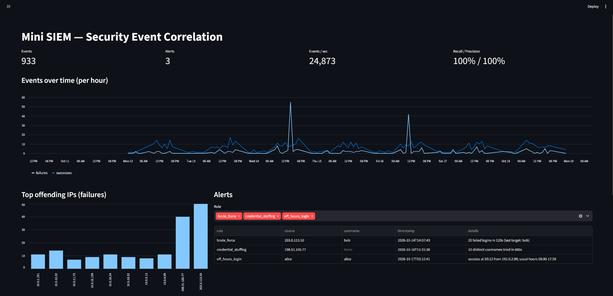

# Mini SIEM: Security Event Correlation Engine

A small SIEM I built in Python. It reads SSH authentication logs into SQLite, walks through
them once with sliding window counters to catch attack patterns that you can't see in any
single log line, and then grades itself: how fast it runs and how accurate it is against
attacks I planted and labeled ahead of time.



## Results

Measured on my Windows laptop with Python 3.13, single thread, using `python run.py`:

| Dataset | Events | Load (parse + insert) | Detect (3 rules) | Total | End to end throughput | Recall | Precision |
|---|---:|---:|---:|---:|---:|---:|---:|
| default (7 days)  |     933 | 0.013 s | 0.026 s | 0.040 s | ~23,000 ev/s | 3/3 = 100% | 3/3 = 100% |
| 365 days × 30/day | 238,069 | 3.55 s  | 4.72 s  | 8.26 s  | ~28,800 ev/s | 3/3 = 100% | 3/3 = 100% |

Throughput holds steady (it actually goes up a little, since the fixed startup cost gets spread
out) even though the second dataset is 255 times bigger. That's because every rule is a single
O(n) pass with a small amount of state per IP or user, so nothing ever turns into an n² problem.
The same run on a Linux machine got about 52,000 ev/s. The difference is mostly Windows file I/O
and SQLite commit cost.

Precision was only **64%** on my first run. The "What I learned" section at the bottom covers
the two bugs that fixed that.

## What it detects

| Rule | Pattern | State kept | Threshold (defaults in `rules.py`) |
|---|---|---|---|
| `brute_force` | one IP hammers passwords | per IP deque of failure timestamps | 20 or more failures in a 2 minute window |
| `credential_stuffing` | one IP tries a bunch of *different* accounts | per IP deque of (time, user) plus a counter of distinct users in the window | 10 or more distinct usernames in 10 minutes |
| `off_hours_login` | a user logs in at an hour they've never been near before | per user set of hours seen in past successful logins | 10 or more past successes and more than 3 hours outside their usual window |

The off hours rule has no hard coded "business hours". Each user's normal window is learned
from their own history as the smallest arc on a 24 hour clock that covers every hour they've
successfully logged in at. So a night shift user who always logs in at 2 AM never gets flagged,
but a 9 to 5 user who shows up at 3 AM does.

## Layout

```
minisiem/
  generator.py   fake auth.log + labels.json with three planted attacks
  parser.py      auth.log line -> {timestamp, username, source_ip, success}  (ISO or syslog format)
  db.py          SQLite schema (events, alerts), batch insert, SQL views for the dashboard
  rules.py       the three detection rules (pure functions, so they're easy to test)
  evaluate.py    alerts vs labels -> recall and precision
run.py           full pipeline with time.perf_counter() timing -> data/benchmark.json
dashboard.py     Streamlit: events over time, top offending IPs, alerts table
tests/           pytest: for every rule, one case that should fire and one that shouldn't
```

## Running it

```bash
pip install -r requirements.txt

python -m minisiem.generator          # makes data/auth.log and data/labels.json
python run.py                         # makes data/siem.db and data/benchmark.json, prints the numbers above
streamlit run dashboard.py            # dashboard at http://localhost:8501
pytest -q                             # 16 tests
```

For a bigger benchmark: `python -m minisiem.generator --days 365 --per-day 30`, then `python run.py`.

It also works on real logs: `python run.py --log /var/log/auth.log --year 2026`. Syslog lines
don't include a year, so `--year` fills it in. Without a labels file you still get throughput
and alerts, just no recall or precision.

## How the ground truth works

`generator.py` writes about 900 events of normal traffic (16 daytime users and 2 night shift
users, each with their own home IPs and the occasional typo'd password) and then plants three
attacks. Each one gets recorded in `labels.json` with its rule, source, and time window:

1. `203.0.113.50` fails 50 times in about 2 minutes against `bob`
2. `198.51.100.77` cycles through 40 usernames, one failure each, 10 seconds apart
3. `alice`, who has only ever been seen between 8 AM and 6 PM, logs in successfully at 3:12 AM from a new IP

`evaluate.py` counts an alert as a true positive when the rule and source match a label and
the alert fired inside the label's window (with 2 minutes of slack, since a threshold gets
crossed partway through an attack, not at the very end). Recall is labels matched divided by
total labels. Precision is matched alerts divided by total alerts.

## What I learned

The first full run scored 100% recall but only **64% precision**: 11 alerts for 3 attacks.
Three things were going on.

- **Duplicate alerts per burst.** A 50 failure burst crossed the 20 failure threshold twice,
  so brute force fired twice. Fix: after an alert, suppress that source for one window length.
- **Holes in the baseline.** The off hours rule was comparing the login hour against the *set*
  of hours seen, so a user seen at 8 AM and 5 PM but never at noon got flagged at 12:37. Fix:
  treat the baseline as one continuous span (the complement of the biggest gap on the clock)
  and allow a few hours of tolerance around it.
- **Overlapping rules aren't bugs.** With stuffing attempts 6 seconds apart, that same IP also
  produced 20 failures in 2 minutes, so brute force fired on it too. That alert is actually
  *correct*, and a real SOC would want it, but it made the ground truth ambiguous. So the
  generator now spaces stuffing attempts 10 seconds apart. The takeaway: precision against
  labels measures how much you agree with whoever wrote the labels, not whether you found
  the truth.
